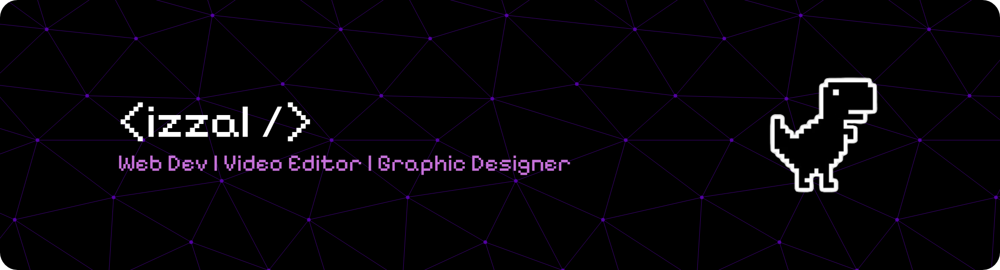

<!-- ## Hi there 👋 -->

<!--
**Izzal-code/Izzal-code** is a ✨ _special_ ✨ repository because its `README.md` (this file) appears on your GitHub profile.

Here are some ideas to get you started:

- 🔭 I’m currently working on ...
- 🌱 I’m currently learning ...
- 👯 I’m looking to collaborate on ...
- 🤔 I’m looking for help with ...
- 💬 Ask me about ...
- 📫 How to reach me: ...
- 😄 Pronouns: ...
- ⚡ Fun fact: ...
-->

## Me?

I am an undergraduate student at Stekom University majoring in Informatics Engineering, and I am interested in Web Development, Graphic Design, and Video Editing.

## My skill

## Connect w/ me

 

## Play w/ me C'mon

<picture data-importer="pacman">
  <source media="(prefers-color-scheme: dark)" srcset="https://raw.githubusercontent.com/Izzal-code/Izzal-code/pacman-output/pacman-contribution-graph-dark.svg?game=pacman">
  <source media="(prefers-color-scheme: light)" srcset="https://raw.githubusercontent.com/Izzal-code/Izzal-code/pacman-output/pacman-contribution-graph.svg?game=pacman">
  
</picture>
